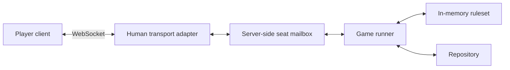

# Mahjong backend redesign

This document set records the backend architecture agreed in the September 30,
2026 design conversation, organized by component on October 2, 2026. It is the
starting point for the replacement design. Component responsibilities and
lifecycle decisions are agreed; detailed interfaces remain proposals where
marked. The initial Rust library implementation is specified in the
[implementation contract](implementation.md); server transport remains unwired.

The root Cargo workspace and its initial `mahjong` binary crate provide
the Rust implementation foundation. The entry point currently exits without
starting a service. The engine library and generic ruleset contracts are implemented. See the
[Rust backend guide](../../../README.md) for development commands.

The existing system supplies lessons and behavior examples. Its package layout,
runtime topology, APIs, and storage formats do not determine this design. The
[technical baseline](../../../../apps/docs/architecture/technical-baseline.md), [ADRs](../../../../apps/docs/decisions/README.md),
and [roadmap](../../../../apps/docs/roadmap.md) continue to describe the existing implementation
and its delivery status. Replacement compatibility and migration behavior remain
to be specified before implementation or deployment.

## Component documents

| Component               | Responsibility                                                                                | Document                            |
| ----------------------- | --------------------------------------------------------------------------------------------- | ----------------------------------- |
| Game runner             | Coordinate participants, batches, deadlines, lifecycle, persistence, and publication.         | [Runner](runner.md)                 |
| Ruleset                 | Define legality, transitions, responding seats, available moves, and hand and match outcomes. | [Ruleset](ruleset.md)               |
| Seat mailbox            | Provide a stable server-side participant interface and supply fallback moves.                 | [Seat mailboxes](seat-mailboxes.md) |
| Human transport adapter | Connect a human participant through WebSockets and manage connection details.                 | [Transport](transport.md)           |
| Repository              | Load and persist authoritative game and coordination progress under the runner's control.     | [Repository](repository.md)         |

The runner communicates through seat mailboxes and does not observe WebSocket
connection status. The ruleset has no transport or storage dependency. Human and
bot participants may share the mailbox interface, but bot implementation is
outside the current scope. The human mailbox still supplies fallback moves.

## Session and game hierarchy

A session hosts successive matches, and each match contains multiple hands.
Here, a game means a full match. Session identity is independent of the lifetime
of a runner instance or an individual match.

- A match starts when every required seat is occupied and ready.
- Seats remain assigned throughout the match, including between hands.
- Participants are implicitly ready between hands. The intermission is
  configurable and initially five seconds.
- A player may request a stop during a hand. Agreement is collected immediately,
  but a unanimous stop takes effect only after that hand finishes and is scored.
- A stop request without unanimous agreement expires at its target hand boundary.
- A completed or stopped match preserves its results. It is terminal rather than
  awaiting resumption. Another fresh match can start in the same session when
  every seat readies again.
- A restarted runner restores the existing match and coordination progress;
  restarting the process does not create a fresh game.

The [runner document](runner.md) owns the detailed lifecycle and stop protocol.

## Shared boundaries

The server is authoritative. Each proposed gameplay move is validated against
the current ruleset state before the runner collects it in its response buffer.
The runner waits for one valid response from every requested seat, then submits
the complete batch to the ruleset for resolution.

A transition produces a candidate next state. The runner persists the transition
and related coordination changes before adopting it or publishing updates. A
failed save cannot advance accepted game state.

Mailboxes and clients receive only permitted seat views and available actions.
Canonical state and internal events stay inside the authoritative boundary.
Ruleset decisions receive any required time, identifiers, and randomness as
explicit inputs.

## Original design sequence and scope

The [implementation contract](implementation.md) resolves the Rust interface and
local persistence proposals below. Concrete ruleset implementations remain separate work.

Response validation is settled: current state plus a proposed transition returns
a validity result without changing state. The next topic is the
[ruleset transition result](ruleset.md#transition-result-proposal): candidate next
state, next opportunities, and semantic hand or match outcomes.

Then define runner and mailbox messages and the repository's coordination
record. A bounded end-to-end implementation should prove recovery before the
remaining implementation structure is chosen.

Match length, dealer and round advancement, draws, and score semantics require an
explicit ruleset profile. This architecture does not choose new Mahjong rules.
Persisting match results does not yet choose a cross-session leaderboard or
lifetime account-balance policy.
